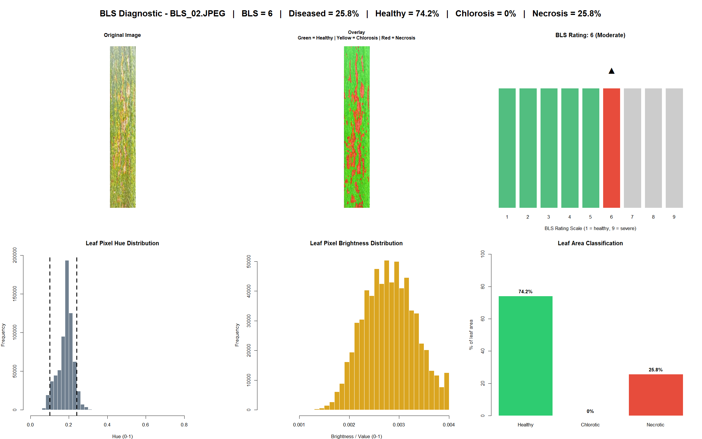

# BLS Image Analyzer

**BLS Image Analyzer** is an R-based image phenotyping pipeline for semi-automated assessment of bacterial leaf streak (BLS) symptoms from leaf images.

The pipeline separates leaf tissue from a dark background, converts RGB image information to HSV color space, classifies detected leaf pixels into **healthy, chlorotic, and necrotic tissue**, quantifies symptomatic leaf area, and converts image-derived disease severity into a **1–9 BLS rating**.

The resulting BLS ratings are further grouped into **Resistant, Moderately Resistant, Moderately Susceptible, and Highly Susceptible** disease-response categories.

---

## Features

BLS Image Analyzer provides:

- Automatic detection of leaf tissue against a dark/black background
- RGB-to-HSV color conversion
- Pixel-based classification of:
  - Healthy tissue
  - Chlorotic tissue
  - Necrotic tissue
- Estimation of healthy leaf area (%)
- Estimation of chlorotic leaf area (%)
- Estimation of necrotic leaf area (%)
- Calculation of total diseased leaf area (%)
- Conversion of image-derived disease severity to a 1–9 BLS rating
- Classification of BLS ratings into disease-response categories
- Green/yellow/red classification overlays
- Diagnostic plots for evaluating image classification
- Batch processing of multiple images
- Support for JPG, JPEG, and PNG images
- Preservation of original image/sample filenames in generated outputs
- CSV output
- Excel output
- Individual image-analysis panels
- Compiled PDF report

---

## Workflow

The general image-analysis workflow is:

```text
Leaf image
    |
    v
Leaf/background segmentation
    |
    v
RGB color extraction
    |
    v
RGB -> HSV conversion
    |
    v
Pixel classification
    |
    +----------------+----------------+
    |                |                |
    v                v                v
 Healthy         Chlorotic         Necrotic
  Green            Yellow             Red
    |                |                |
    +----------------+----------------+
                     |
                     v
           Diseased leaf area (%)
                     |
                     v
               BLS rating
                  1–9
```

---

## Image Classification

Detected leaf pixels are assigned to three mutually exclusive tissue classes.

| Tissue class | Overlay color | Interpretation |
|---|---|---|
| Healthy | Green | Detected leaf tissue not classified as chlorotic or necrotic |
| Chlorotic | Yellow | Yellow/chlorotic symptomatic tissue |
| Necrotic | Red | Brown or dark necrotic symptomatic tissue |

Total diseased leaf area is calculated as:

```text
Diseased area (%) =
Chlorotic area (%) + Necrotic area (%)
```

The classification overlay is semi-transparent so that the original leaf remains visible beneath the classified pixels.

---

## BLS Rating Scale

The current version converts total image-derived diseased leaf area into a 1–9 rating using the following implemented thresholds:

| BLS rating | Diseased leaf area (%) |
|---:|---:|
| 1 | 0–0.5 |
| 2 | >0.5–2 |
| 3 | >2–6 |
| 4 | >6–12 |
| 5 | >12–25 |
| 6 | >25–40 |
| 7 | >40–60 |
| 8 | >60–75 |
| 9 | >75 |

The disease percentage used for scoring is:

```text
Chlorotic area + Necrotic area
```

> **Important:** These thresholds represent the disease-severity-to-rating conversion implemented in the current version of BLS Image Analyzer. Image-derived ratings should be validated for the imaging conditions, plant material, and experimental system in which the software is used.

---

# Installation

## R

A recent version of R is recommended.

## Required R Packages

BLS Image Analyzer requires:

- `magick`
- `openxlsx`
- `dplyr`
- `png`

Install the required packages once using:

```r
install.packages(
  c(
    "magick",
    "openxlsx",
    "dplyr",
    "png"
  )
)
```

The analyzer checks whether the required packages are available before beginning the analysis.

---

# Input Images

The current image-analysis pipeline is designed primarily for leaf images photographed against a **dark or black background**.

For best results:

- Use clearly visible leaf tissue
- Use a dark or black background
- Maintain good contrast between leaf and background
- Keep illumination as consistent as possible
- Minimize strong shadows
- Minimize glare and reflections
- Keep the leaf within the image frame
- Avoid unrelated objects in the image

Supported image formats are:

```text
JPG
JPEG
PNG
```

Image filenames do not need to follow a numeric naming system.

The original filename is retained as the image identifier in the generated results.

---

# Recommended Image Acquisition

For quantitative image phenotyping, users are encouraged to maintain consistent image-acquisition conditions.

Where possible:

1. Use the same camera or imaging system.
2. Maintain similar camera settings.
3. Maintain a consistent camera-to-leaf distance.
4. Use the same background.
5. Maintain similar lighting conditions.
6. Avoid strong shadows.
7. Avoid direct reflections or glare.
8. Keep the complete leaf within the image frame.
9. Avoid unrelated plant material or objects.
10. Use a consistent image-acquisition protocol throughout an experiment.

Differences in illumination, exposure, camera settings, background, and image processing can influence pixel classification.

---

# Repository Structure

A typical BLS Image Analyzer repository can be organized as:

```text
BLS-Image-Analyzer/
│
├── BLS_Image_Analyzer.R
├── README.md
├── LICENSE
├── CITATION.cff
├── .gitignore
│
├── docs/
│   └── scoring_method.md
│
├── example_data/
│   ├── BLS_01.JPEG
│   ├── BLS_02.JPEG
│   └── BLS_03.JPEG
│
└── example_output/
```

The repository also contains three related tools built on the same scoring rules:

| Folder | Language | What it is |
|---|---|---|
| `BLS_Image_Analyzer.R` | R | The original analyzer (this README) |
| `app/` | JavaScript | BLS Leaf Scorer, a web app for phones and PCs, in rating mode: raters score each leaf by eye before the app does. <https://tapishpwr24.github.io/BLS_Image_Analyzer/app/> (share page: <https://tapishpwr24.github.io/BLS_Image_Analyzer/>) |
| `study/` | | Former test address; forwards to `app/` |
| `python/` | Python | Batch analyzer for whole photo folders (automatic leaf finding on any background) and the rater-study evaluation (`bls_analyzer.study`); see `python/README.md` |

---

# Running BLS Image Analyzer

## 1. Download the Repository

Download or clone the repository to your computer.

The main analysis script is:

```text
BLS_Image_Analyzer.R
```

Open the script in R or RStudio.

---

## 2. Set the Input Folder

Near the beginning of `BLS_Image_Analyzer.R`, specify the directory containing the leaf images.

For example:

```r
INPUT_FOLDER <- "example_data"
```

To analyze images located in the current working directory:

```r
INPUT_FOLDER <- "."
```

An absolute path can also be used.

### Windows

```r
INPUT_FOLDER <- "C:/Users/username/Desktop/BLS_images"
```

### macOS

```r
INPUT_FOLDER <- "/Users/username/Desktop/BLS_images"
```

### Linux

```r
INPUT_FOLDER <- "/home/username/BLS_images"
```

The script uses `file.path()` and platform-independent path handling where appropriate.

---

## 3. Set the Output Folder

Specify where results should be generated.

For example:

```r
OUTPUT_FOLDER <- "BLS_Image_Analyzer_results"
```

The required output directories will be created automatically.

To reproduce the example analysis, you can use:

```r
INPUT_FOLDER  <- "example_data"
OUTPUT_FOLDER <- "example_output"
```

---

## 4. Run the Analyzer

Run the complete script from R with:

```r
source("BLS_Image_Analyzer.R")
```

Alternatively, open the script in RStudio and run the complete file.

When the analysis starts, the console reports:

- Software name
- Software version
- Input folder
- Output folder
- Number of detected images
- Image filenames
- Processing progress
- Healthy area
- Chlorotic area
- Necrotic area
- Total diseased area
- BLS rating

---

# Output Structure

A standard analysis generates:

```text
BLS_Image_Analyzer_results/
│
├── 01_overlay_images/
├── 02_panel_images/
├── 03_overlay_only_plots/
├── 04_diagnostic_only_plots/
├── 05_full_diagnostic_plots/
├── 06_compiled_reports/
├── BLS_results.csv
└── BLS_results.xlsx
```

When `OUTPUT_FOLDER <- "example_output"` is used, the same structure is generated inside `example_output/`.

---

## 01_overlay_images

Contains the classification overlay for each analyzed image.

Overlay colors:

- **Green** = Healthy
- **Yellow** = Chlorotic
- **Red** = Necrotic

The original leaf remains visible underneath the semi-transparent classification layer.

For an input image such as:

```text
BLS_01.JPEG
```

the corresponding overlay is saved using the original image identifier:

```text
BLS_01_overlay.png
```

---

## 02_panel_images

Contains formatted side-by-side panels showing:

- Original leaf image
- Classification overlay
- BLS rating
- Total diseased area
- Healthy area
- Chlorotic area
- Necrotic area
- Classification legend

These panels provide a convenient visual summary for each analyzed image.

---

## 03_overlay_only_plots

Contains side-by-side comparisons of:

1. Original image
2. Classification overlay

These figures are useful for quickly assessing whether the automated classification corresponds to visible leaf symptoms.

---

## 04_diagnostic_only_plots

Contains diagnostic information used to evaluate image classification.

Diagnostic plots include:

- Leaf-pixel hue distribution
- Leaf-pixel saturation distribution
- Leaf-pixel brightness distribution
- Healthy/chlorotic/necrotic area classification

---

## 05_full_diagnostic_plots

Contains a complete six-panel diagnostic figure for each analyzed image.

The diagnostic figure includes:

1. Original image
2. Classification overlay
3. BLS rating
4. Leaf-pixel hue distribution
5. Leaf-pixel brightness distribution
6. Healthy/chlorotic/necrotic leaf-area classification

The figure title additionally reports:

- BLS rating
- Total diseased area (%)
- Healthy area (%)
- Chlorotic area (%)
- Necrotic area (%)

Visual inspection of these diagnostic figures is recommended as part of quality control.

### BLS_Score_Scale

Contains the 1–9 BLS scoring intervals and corresponding disease-response categories used by the analyzer. See the **BLS Rating Scale** and **Disease-Response Categories** sections above for interpretation.
---

## 06_compiled_reports

Contains a multi-page PDF report.

Each analyzed leaf is presented on a separate landscape page containing:

- Original image
- Classification overlay
- BLS score
- Disease percentage
- Tissue-class percentages
- Overlay legend

Panel pages are organized according to the corresponding image filenames.

---

# Tabular Results

## CSV Output

The file:

```text
BLS_results.csv
```

contains image-level quantitative results.

Variables include:

- `Image_ID`
- `Image_File`
- `Leaf_Pixels`
- `Healthy_Pixels`
- `Chlorotic_Pixels`
- `Necrotic_Pixels`
- `Healthy_Percent`
- `Chlorotic_Percent`
- `Necrotic_Percent`
- `Total_Diseased_Percent`
- `BLS_Score`
- `Disease_Response`
- `QC_Status`
- Output-file locations

The original input filename is preserved in `Image_File`, while the filename without its extension is used as `Image_ID`.

---

## Excel Output

The file:

```text
BLS_results.xlsx
```

contains multiple worksheets.

### Per_Image

Contains quantitative results for every successfully analyzed image.

### Summary

Contains overall summary statistics, including:

- Number of images
- Mean disease percentage
- Mean BLS score
- Median BLS score
- Minimum BLS score
- Maximum BLS score

---

# Quality Control

Healthy, chlorotic, and necrotic pixels are mutually exclusive classes.

Therefore, for a successfully analyzed leaf:

```text
Healthy proportion
+ Chlorotic proportion
+ Necrotic proportion
= 1
```

The software checks this relationship for each image.

The output includes a `QC_Status` variable.

Possible values include:

```text
PASS
CHECK
FAILED
```

Users should also visually inspect classification overlays and diagnostic figures before using image-derived measurements for downstream quantitative analyses.

---

# Interpretation of Results

BLS Image Analyzer provides both a continuous measurement and a categorical disease rating.

## Continuous Disease Severity

The primary continuous measurement is:

```text
Total_Diseased_Percent
```

This represents the percentage of detected leaf area classified as chlorotic or necrotic.

It is calculated as:

```text
Total_Diseased_Percent =
Chlorotic_Percent + Necrotic_Percent
```

---

## BLS Score

Continuous disease severity is converted into:

```text
BLS_Score
```

on a 1–9 scale.

Retaining both measurements allows users to work with the continuous image-derived disease estimate or the corresponding rating.

---

## Disease-Response Categories

Image-derived BLS scores are grouped into four disease-response categories:

| BLS score | Disease-response category |
|---:|---|
| 1–<3 | Resistant |
| 3–<5 | Moderately Resistant |
| 5–<7 | Moderately Susceptible |
| 7–9 | Highly Susceptible |

These categories provide a simplified interpretation of the image-derived 1–9 BLS rating.
---

# Reproducibility

For reproducible experiments, users are encouraged to record:

- BLS Image Analyzer version
- R version
- R package versions
- Camera or imaging system
- Image resolution
- Camera settings
- Lighting conditions
- Background
- Image-acquisition protocol
- Any modifications to classification parameters

The software version should be reported when results are used in publications or other research outputs.

---

# Limitations

BLS Image Analyzer performs image-based classification of visible leaf characteristics. It does not independently determine the biological cause of symptoms or confirm the presence of a pathogen.

Classification may be influenced by:

- Uneven illumination
- Strong shadows
- Reflections and glare
- Image overexposure
- Image underexposure
- Natural leaf senescence
- Nutrient-related chlorosis
- Mechanical injury
- Symptoms caused by other pathogens
- Background objects
- Differences among cameras
- Image-processing differences

Consequently, the software should be used with appropriately characterized plant material and standardized image-acquisition procedures.

For quantitative research applications, image-derived measurements should be evaluated using representative samples and appropriate reference assessments.

---

# Example Data

The `example_data/` directory contains representative images that can be used to test the analyzer.

For example:

```text
example_data/
├── BLS_01.JPEG
├── BLS_02.JPEG
└── BLS_03.JPEG
```

To analyze these images:

```r
INPUT_FOLDER  <- "example_data"
OUTPUT_FOLDER <- "example_output"
```

Then run:

```r
source("BLS_Image_Analyzer.R")
```

---

# Example Output

Running the example images generates classification overlays, image panels, diagnostic figures, quantitative results, and a compiled report.

Once an example diagnostic figure is included in the repository, it can be displayed here using:

```markdown

```

---

# Software Version

Current release:

**BLS Image Analyzer v1.0.0**

---

# Citation

If you use BLS Image Analyzer in research, please cite the software.

Citation metadata are provided in:

```text
CITATION.cff
```

A formal publication or DOI can be added to the citation information when available.

---

# Author

**Tapish Pawar**

Department of Agronomy, Horticulture and Plant Science  
South Dakota State University  
Brookings, South Dakota, USA

---

# License

This project is distributed under the license provided in the repository `LICENSE` file.

---

# Disclaimer

BLS Image Analyzer is intended for research and educational use.

Users are responsible for determining whether the classification parameters and scoring system are appropriate for their experimental conditions and intended application.